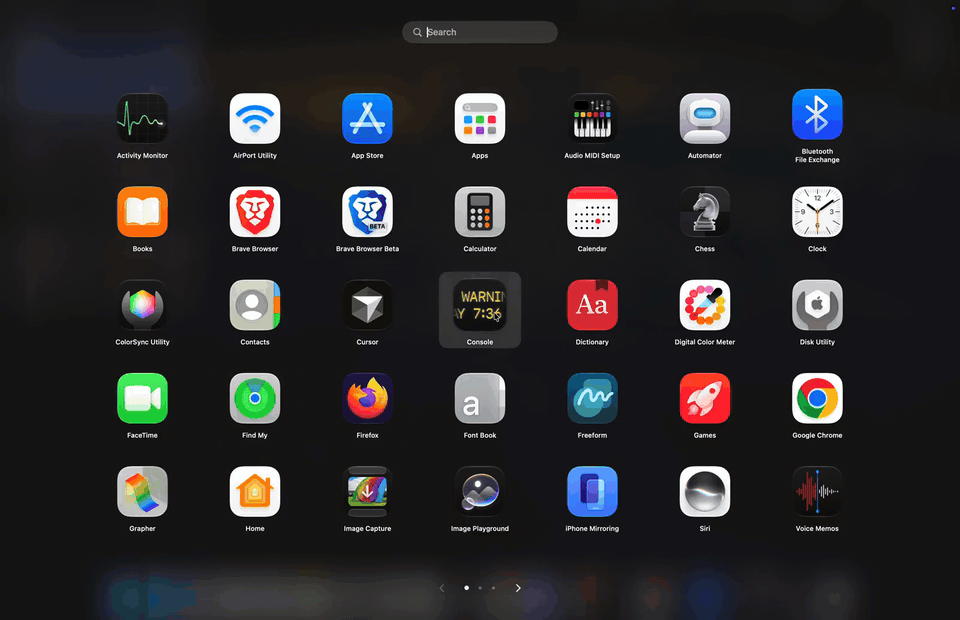
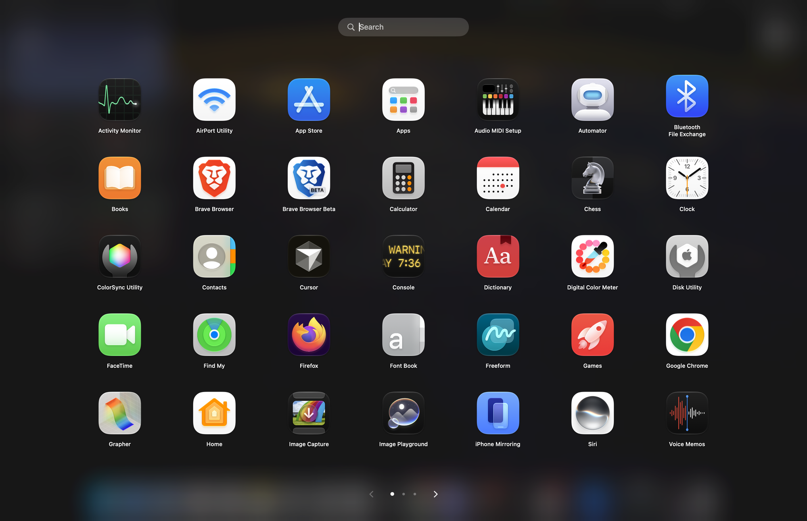
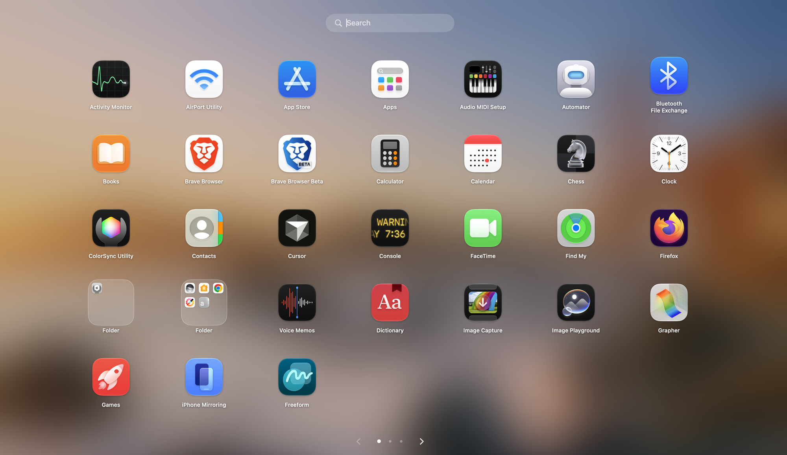
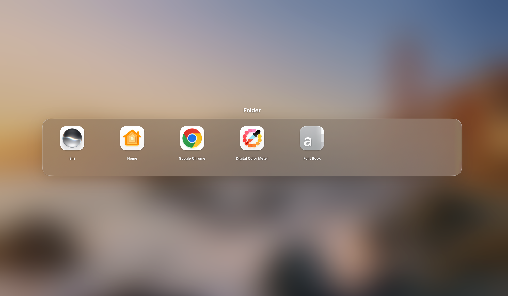
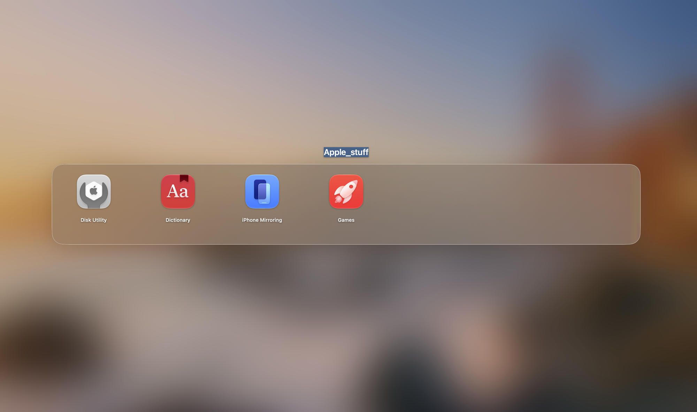

# GridBack

**A free, open-source replacement for the classic macOS Launchpad.**



GridBack is a free menu-bar app for Mac. It opens a full-screen grid of your apps, so you can see them, keep them in the order you like, and click one to open it.

This is version 0.3.2. It is open source, and it is not a finished product.

## What works









These were checked on a real Mac running macOS 27, built with Xcode 27.2.

- A grid icon sits in the menu bar. Click it for **Open GridBack**, **Settings…**, and **Quit GridBack**.
- The shortcut is **Control-Option-G**. It works while another app is in front. The same shortcut closes the grid. You can change it in Settings.
- Settings has **Start GridBack at login**. It is off until you turn it on. When you log in, GridBack stays in the menu bar and does not open the grid.
- Type to search for an app. Search also finds an app that is inside a folder, and clicking the result opens that app.
- Escape clears the search. If a folder is open, the next Escape closes the folder. One more Escape closes the grid.
- Click an app to open it.
- Drag apps to rearrange them. The new order is still there after you quit and open GridBack again.
- Drag an app onto another app and rest there briefly. GridBack makes a folder with those two apps and opens it. Resting on a folder that already exists adds the app to it.
- Hold an app on an existing folder for about a second. The folder opens while you are still holding the app. Move into the folder and let go in a gap to place it there. Let go outside the folder and the app stays on the grid.
- Open a folder and drag an app out. The icon stays under the pointer, the folder closes, and you can drop the app in a gap on the grid.
- Inside an open folder you can drag apps into a new order. Click an empty part of the screen to close the folder. The folder grows out of its tile when it opens, and it shrinks back into that tile when it closes. The rest of the grid fades out and back in place. If Reduce Motion is on, the folder opens and closes without that movement.
- Drag an app to the left or right edge of the screen to move it to another page.
- Change pages with a two-finger swipe on the trackpad, the left and right arrow keys, or the arrows on the screen.
- The grid covers the menu bar. The real Dock stays visible underneath the grid, including when Dock magnification is on.
- The grid can open on top of an app that is in full screen.
- GridBack remembers the page you were on, and it remembers your folders.
- If you have another monitor connected, the grid appears on the main display.
- The menu-bar icon is a cream and black grid.

## What this version does not do

The pinch gesture on the trackpad is not in this version. You also cannot drag an app from the grid onto the real macOS Dock.

## Known issues

- Escape does not cancel a drag that is already underway. Let go of the pointer to finish the drag, then press Escape.
- Dragging along the edge of a row can slide the icon you are aiming at before a folder has time to form.
- The first time the grid opens on a HEIC desktop picture, macOS may write a Hang Risk line to the log. The grid still opens. The message is harmless.

The app is unsigned and not notarized. macOS will warn you the first time you open a downloaded copy. That is expected. See below.

## What you need

An Apple silicon Mac running **macOS 26 or later**. That is the minimum set in the Xcode project. The app is built for Apple silicon only.

## Install

### Homebrew

On an Apple silicon Mac with Homebrew:

```
brew install --cask jimmythefallony/gridback/gridback
```

On Homebrew 6 or later, that full name trusts only this cask. The first time you open GridBack, choose **Open Anyway** in **System Settings > Privacy & Security**, then confirm with your password or Touch ID. Homebrew does not remove that warning.

To remove GridBack and its saved layout:

```
brew uninstall --cask --zap jimmythefallony/gridback/gridback
```

Uninstalling does not turn off Start at login. Remove GridBack in **System Settings > General > Login Items**.

### Download the zip

1. Open the [GitHub Releases](https://github.com/jimmythefallony/gridback/releases) page for this project and download **GridBack-v0.3.1.zip**.
2. Unzip it.
3. Move **GridBack.app** into your Applications folder.

The first time you open it, macOS says it cannot verify the developer. GridBack is free and open source, and it is not signed with a paid Apple developer certificate. macOS shows that warning for apps like this.

On current macOS, including macOS 26 and 27, Apple’s own steps are:

1. Try to open GridBack. When the warning appears, close it. Leave the app where it is.
2. Open the Apple menu and choose **System Settings**.
3. Click **Privacy & Security** in the sidebar. You may need to scroll to find it.
4. Scroll down to **Security** and click **Open Anyway**. macOS shows that button for about an hour after you tried to open the app. If it is not there, open GridBack once more, close the warning, and come straight back to this screen.
5. The warning appears again. Click **Open**.
6. Enter your Mac login password and click **OK**.

After that, you can open GridBack by double-clicking it, the same as any other app.

You can also try a right-click (or Control-click) on the app, choose **Open**, then **Open** again. On current macOS that choice is often not offered for an app that is not signed and notarized. If you do not see it, use **Privacy & Security** as above. These steps follow Apple’s guide, [Safely open apps on your Mac](https://support.apple.com/en-us/102445).

## Build it yourself

You need an Apple silicon Mac with macOS 26 or later, and Xcode.

1. Download this project and unzip it, or clone the repository.
2. Double-click **GridBack.xcodeproj**.
3. At the top of Xcode, set the destination to **My Mac**.
4. Press **Run** (the play button).

The copy that was checked for this release was built with Xcode 27.2.

## Tell us what happened

If something does not work the way you expected, open an issue:

https://github.com/jimmythefallony/gridback/issues

Please include your macOS version, what you expected, and what happened instead.

## What comes next

The pinch gesture is still to come. We will keep refining the app from what testers report.

## License

GridBack is released under the [MIT License](LICENSE). Copyright 2026 jimmythefallony.
